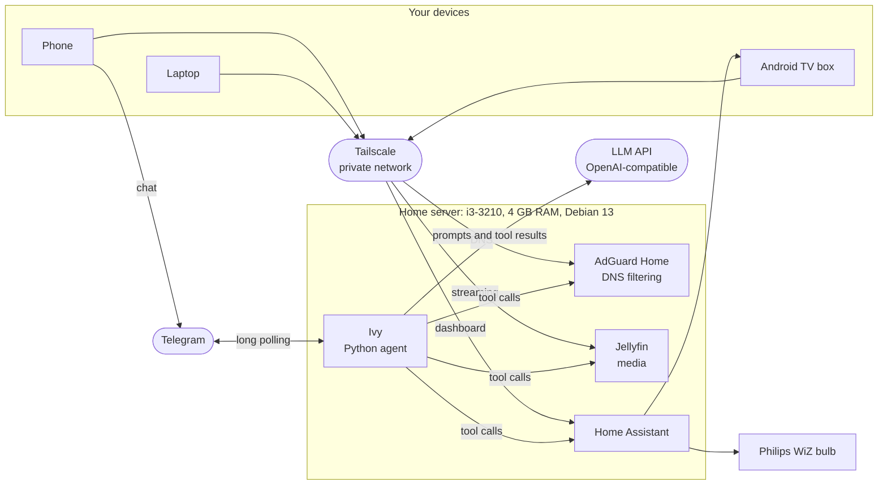

# Ivy

A self-hosted AI home assistant that runs on a 2012 PC and controls the house, the media server and the network's ad blocking from a Telegram chat.

## The story

The PC had been sitting unused for years: an Intel Core i3-3210 ("Ivy Bridge"), 4 GB of RAM, a generic H61 motherboard, a GT 710 and a 1 TB hard drive. Instead of throwing it out, I turned it into a headless home server running Debian 13.

It now runs, around the clock:

- **AdGuard Home** for network-wide ad and tracker blocking, with the AdGuard DNS filter and HaGeZi Pro (about 400k rules). Tailscale hands it out as the DNS server to every device on the tailnet, so phones get ad blocking on mobile data too, and an Android TV box (Tata Play Binge) no longer shows Hotstar ads.
- **Jellyfin** for movies and shows, streamed to the TV box and phones.
- **Home Assistant** for a Philips WiZ bulb and the TV box.
- **Samba** for a shared folder on the 1 TB disk.
- **Ivy**, a Python bot that ties it all together. You talk to her on Telegram (Discord works too), and she uses tool calls to an LLM to act on everything above.

She is named after the Ivy Bridge CPU she runs on.

## What Ivy can do

- Switch lights and devices on and off, and set a bulb's colour, brightness or white temperature
- Turn the TV box on or off
- Report server health: load, memory, disk space, temperatures, uptime, and whether each service responds
- Show ad-blocking stats and pause ad blocking for a while
- Search the Jellyfin library and list recent additions
- Save notes and send reminders at a set time

Some exchanges (illustrative):

```text
You:  turn the bedroom light blue, 40%
Ivy:  Done, the bedroom light is blue at 40%.

You:  make it warm white instead
Ivy:  Switched it to warm white (2700 K).

You:  do we have Interstellar?
Ivy:  Yes, Interstellar (2014) is in the library.

You:  is the server ok?
Ivy:  All good. Home Assistant, Jellyfin and AdGuard are all up, and there's plenty of disk space left.

You:  pause ad blocking for 30 minutes, a site isn't loading
Ivy:  Should I do this?
      • Pause ad blocking for 30 minutes
      Reply yes to confirm.
You:  yes
Ivy:  Ad blocking is paused for 30 minutes.

You:  remind me at 9 tomorrow to pay the electricity bill
Ivy:  Reminder set for tomorrow, 09:00.
```

A message from anyone not on the allowlist gets one reply, `Not authorized. Your Telegram user ID is <id>.`, and nothing else.

## Architecture



Every service runs in Docker Compose on the one machine. Ivy reaches Home Assistant, Jellyfin and AdGuard over localhost. Nothing is exposed to the internet: devices reach the server through Tailscale, and Ivy only makes outgoing connections (Telegram long polling and the LLM API).

## Design decisions

- **Any OpenAI-compatible LLM.** Gemini's free tier is the default; OpenAI or Claude work by changing `LLM_BASE_URL` and `LLM_MODEL`. Why: the model runs at the provider, so a 4 GB machine can still run a capable assistant, and switching providers is a config change.
- **Ordered model fallbacks.** `LLM_MODEL` takes a list. If a model is overloaded, rate limited or times out, Ivy tries the next one; other errors (like a bad key) are not retried. Why: free tiers are often busy, and retrying a fixed failure only wastes time.
- **User allowlist.** Ivy only answers user IDs listed in `TELEGRAM_ALLOWED_USER_IDS`. Why: a bot that can control the house must not answer strangers.
- **Confirm only risky actions.** Pausing ad blocking waits for a "yes". Lights and the TV act at once. Why: those are harmless and easy to undo, and asking every time would make the assistant tiresome.
- **Some devices are off limits.** Only lights, switches, fans, climate and media players can be controlled. Locks and alarms can't be, whatever the model asks for. Why: the worst case of a wrong tool call should be a light in the wrong colour.
- **Every tool argument is validated.** Entity IDs, actions, brightness, colour names, colour temperature, pause duration and reminder times are checked in code before anything runs. Tool results are passed back as data, never as instructions. Why: model output is untrusted input.
- **Bounded agent loop.** At most 6 model calls per message. A conversation starts fresh after 30 idle minutes or 60 messages. Why: cost and latency stay predictable, and a confused model can't loop forever.
- **No open ports.** Remote access is Tailscale only, SSH accepts keys only, and the bot uses long polling rather than a public webhook. Why: an old home PC should not be reachable from the internet.
- **Plain, small stack.** Python with asyncio, SQLite for notes and reminders, pinned container versions. Why: fewer moving parts on modest hardware, and nothing updates by surprise.

## Tech stack

- **Assistant:** Python 3.13, `openai` SDK (tool calling), python-telegram-bot, discord.py, httpx, aiohttp, psutil, SQLite
- **Tooling:** uv, pytest, GitHub Actions
- **Server:** Debian 13, Docker Compose, Tailscale, AdGuard Home, Jellyfin, Home Assistant, Samba

## Repository layout

```text
assistant/          Ivy, the Python assistant
  homebot/
    agent.py        conversation loop, model fallbacks, confirmations
    tools.py        tool definitions and argument validation
    channels.py     Telegram and Discord
    app_api.py      JSON API for the planned app, reachable only through Tailscale
    store.py        notes and reminders in SQLite
    config.py       settings from environment variables
  tests/            pytest suite with a mocked LLM and mocked services
docker-compose.yml  AdGuard Home, Jellyfin, Home Assistant and Ivy
docs/setup.md       full setup guide, from BIOS to a running assistant
```

## Quick start

The full walkthrough, from BIOS settings and installing Debian to configuring each service, is in [docs/setup.md](docs/setup.md). In short, on a Debian machine with Docker and Tailscale:

```sh
git clone https://github.com/C0deRatoR/ivy.git ~/homeserver && cd ~/homeserver
mkdir -p data/jellyfin/config data/jellyfin/cache  # Jellyfin runs as uid 1000
cp assistant/.env.example assistant/.env   # add your LLM key, bot token and service credentials
docker compose up -d
```

To work on the assistant without Docker:

```sh
cd assistant
uv run pytest
uv run --env-file .env python -m homebot
```

## Roadmap

- **Cross-platform app (planned).** A Flutter app for phone and desktop to chat with Ivy outside Telegram. The assistant already has a small JSON API for it that is reachable only through `tailscale serve`.
- **"Hey Ivy" voice assistant (planned).** Wake word, speech to text, and spoken replies, using the same agent and tools.
